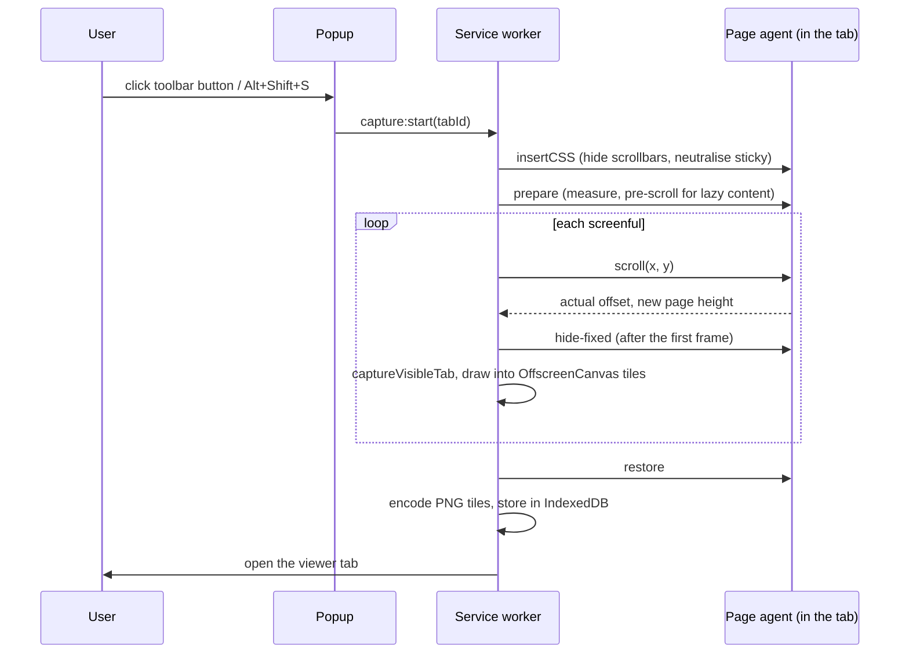

<div align="center">
  
  <h1>Pagesmith</h1>
  <p><strong>A full-page screenshot extension for Chrome. One click captures the whole page as one image or PDF. Nothing leaves your browser.</strong></p>
  <p><a href="https://chromewebstore.google.com/detail/nclcaennencgjadomnglkibooebeipjb">Install from the Chrome Web Store</a> · <a href="https://bcollard.github.io/pagesmith/">Website</a></p>
</div>

---

## Captures never leave your browser

A screenshot tool holds images of whatever you were looking at: mail, bank
statements, internal dashboards. So Pagesmith makes no network requests.

- **No network code in the shipped bundle.** It contains no `fetch`, `XMLHttpRequest`, `WebSocket`,
  `sendBeacon` or remote stylesheet. CI checks the built output, not just the
  source, and fails if one appears. See
  [`scripts/guard-egress.mjs`](scripts/guard-egress.mjs).
- **Local storage only.** Captures are kept in the extension's own IndexedDB on your machine.
  The newest 20 are kept by default, and older ones are deleted
  automatically.
- **No access at install.** Pagesmith uses `activeTab`, so it can see a tab only
  after you click its button or press its shortcut on that tab. The install
  prompt shows no "read and change your data on all websites" warning.

## What it does

- **Full page:** captures the whole page, not just the visible part. It scrolls one
  screen at a time and joins the frames.
- **Fixed and sticky elements:** sticky headers, cookie bars and chat bubbles appear once at the top,
  not on every screen. This is configurable.
- **Lazy-loaded content:** the page is scrolled through once before capturing.
- **Inner scrollers:** apps that scroll an inner panel instead of the page, such as webmail,
  chat and dashboards, are detected, and the panel is captured in full.
- **Export:**
  - PNG or JPEG download
  - PDF in A4, Letter or fit-to-content page sizes
  - copy to the clipboard
- **Very tall pages:** pages taller than Chrome can encode as one image are split
  into several images. The PDF contains all of them.
- **Background capture:** closing the popup does not cancel a capture. It runs in the service
  worker and shows progress on the toolbar badge.
- **Languages:** English, French, German, Spanish and Japanese.

### Limits

- **Restricted pages:** Chrome blocks extensions from `chrome://` pages and other extensions'
  pages. On the Chrome Web Store, scripting is blocked but capturing is not, so
  only the visible area is saved there.
- **Endless feeds:** these are cut off at a configurable height, 40,000 CSS
  pixels by default.
- **No editor:** Pagesmith does no cropping or annotation. Use any image editor.

## Verify the build yourself

You do not have to trust that the extension in the Web Store was built from
this source. You can check it.

```bash
git clone https://github.com/bcollard/pagesmith.git && cd pagesmith
git checkout v0.1.0        # the tag you want to verify
nvm use                    # matches .nvmrc; the Node version affects the output
npm ci
node scripts/verify-reproducible.mjs ~/Downloads/pagesmith-0.1.0.zip
gh attestation verify ~/Downloads/pagesmith-0.1.0.zip --repo bcollard/pagesmith
```

The build is a pure function of the source: fixed timestamps, sorted archive
entries, and no paths from the build machine. The bundle is not minified, so
the JavaScript in the release is the JavaScript you can read. The whole
extension is about 80 KB and has no runtime dependencies.

## How it works



The geometry is in [`src/core/geometry.ts`](src/core/geometry.ts) and
unit-tested without a browser. Each frame is drawn at the scroll offset the
page *reports*, not the one it was asked for. That keeps the last screen from
being duplicated where the browser clamps the scroll. The scale factor is
measured from the first captured frame rather than taken from
`devicePixelRatio`, which is wrong when the tab is zoomed.

## Permissions

| Permission | Why |
| --- | --- |
| `activeTab` | Temporary access to the tab you clicked the button on. Needed for `captureVisibleTab` and for injecting the page agent. |
| `scripting` | Injects the page agent and its stylesheet into that one tab. |
| `storage` | Settings, plus the progress of a running capture. |

That is the full list: no host permissions, no `tabs` and no `downloads`.
Downloads go through a normal link in the viewer page, so Chrome's own download
UI is used. The set is checked against
[`scripts/permissions-baseline.json`](scripts/permissions-baseline.json) in CI.
See [SECURITY.md](SECURITY.md).

## Try it locally

```bash
npm ci
npm run build
make load            # opens chrome://extensions
```

Turn on **Developer mode**, click **Load unpacked**, and pick `dist/chrome`.

## Development

```bash
make help            # every target
make dev             # hot-reloading development build
make check           # everything CI runs, in the same order
make e2e             # capture fixture pages in Chromium and check the pixels
```

The architecture rule: **`src/core` decides, `src/platform` calls the browser,
and `src/core` may not import `chrome` or touch the DOM.** A lint rule and a CI
guard both enforce it.

| Path | Contents |
| --- | --- |
| `src/core/` | Scroll planning, tile layout, settings, filenames, PDF writer. Pure, 95% coverage floor. |
| `src/platform/` | `chrome.*` wrappers, IndexedDB capture store. |
| `src/background/` | The capture loop. |
| `src/entrypoints/` | Service worker, page agent, popup, viewer, options. |
| `e2e/` | Playwright: captures fixture pages and samples pixels at every seam. |
| `scripts/` | Guards, deterministic packer, reproducibility check, icon generator. |

## Prior art

[GoFullPage](https://chromewebstore.google.com/detail/fdpohaocaechififmbbbbbknoalclacl)
is the best-known extension of this kind and is proprietary. Its shipped
package was inspected to see which Chrome APIs and strategies it relies on:
- scroll and `captureVisibleTab` per screenful
- converting fixed elements after the first frame
- a pre-scroll pass for lazy content
- splitting outputs that exceed canvas limits

No code was copied. Pagesmith is written from those observations and the
Chrome API documentation. It differs in a few places:
- the capture runs in the service worker, so it survives the popup closing
- it uses no optional `tabs`, `downloads` or host permissions
- it has no account, premium tier or editor
- it builds PDFs with a small built-in writer

The packaging, guard and release tooling comes from
[Headsmith](https://github.com/bcollard/headsmith) by the same author.

## Licence

MIT. See [LICENSE](LICENSE).
